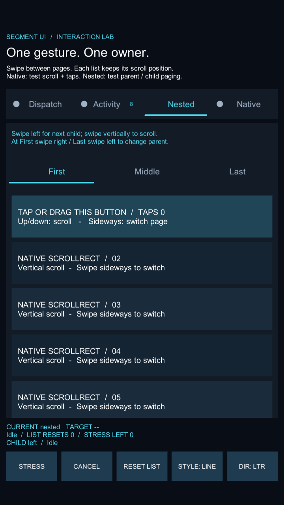
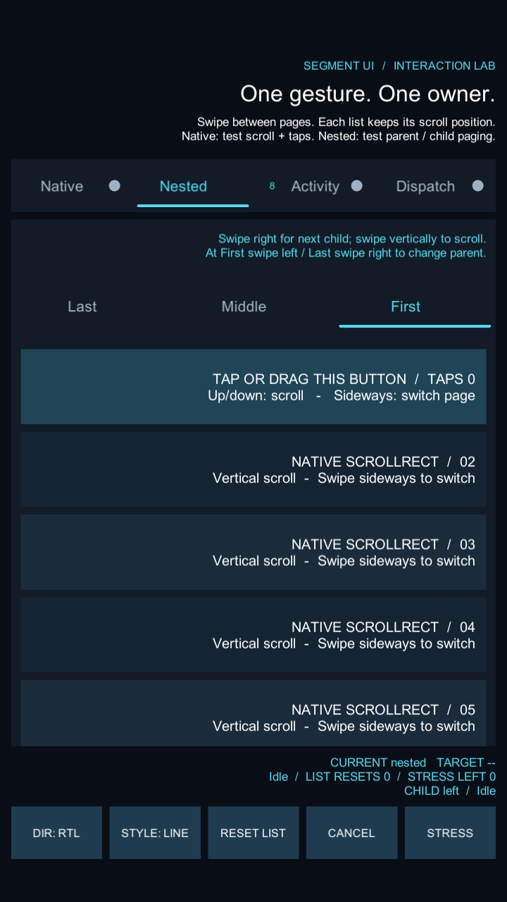

# SegmentUI

面向 Unity UGUI 的分段分页组件。业务布局适配由独立仓库 [RTLLayout](https://github.com/zhangguozhong/RTLLayout) 提供。支持懒加载页面、原生 ScrollRect、嵌套分页，以及 Prefab 编辑模式下的 LTR/RTL 预览。

## 组件职责

| 组件 | 职责 | 核心依赖 |
| --- | --- | --- |
| SegmentUI | 标题、指示器、分页、手势仲裁与页面生命周期 | Unity.ugui |
| RTLLayout | 缓存 LTR 基准、布局镜像、文本对齐与显式图像缩放反转 | Unity.ugui |
| SegmentUI.RTLLayout | 将分页方向同步到业务 Page/Item 的适配根 | 上述两个组件 |

SegmentUI 容器负责排列与分页坐标，RTLLayout 负责业务预制体内部布局。无需接入其他列表框架。

## 安装

验证环境：Unity **2022.3.62f3c1**、UGUI **1.0.0**、Unity Test Framework **1.1.33**。

1. 新建或打开 Unity UGUI 工程。
2. 将本仓库 `Assets/SegmentUI` 连同 `.meta` 文件复制到工程；再从 [RTLLayout 仓库](https://github.com/zhangguozhong/RTLLayout) 导入 `Assets/RTLLayout` 及其 `.meta`，保持路径不变。
3. 通过 Package Manager 安装 UGUI；运行所附测试还需要 Unity Test Framework。
4. 等待脚本编译，选择 **Tools → Segment UI → Open Demo**，进入 Play。

本仓库按 Assets 目录分发，目前不是 UPM 包；不支持直接用 Git URL 在 Package Manager 安装。仅使用 SegmentUI 核心可只导入 Runtime，并自行制作标题和容器 Prefab。生产工程可按各组件文档移除测试及示例目录。

## 演示

Game View 使用竖屏，如 **720×1280** 或 **1080×1920**。演示提供普通页、原生 ScrollRect 页和嵌套 SegmentView 页。

- 点击标题或横向拖动切页，纵向拖动滚动当前页。
- **Native**：原生 ScrollRect 和普通 Button，验证拖动与点击互斥。
- **Nested**：优先切换子页；子页到达边缘后，在下一次手势开始时交给父分页。
- **DIR**：切换 LTR/RTL；**STYLE**：切换指示器；**STRESS**：连续切页；**CANCEL**：取消过渡。

| LTR | RTL |
| --- | --- |
|  |  |

## 快速接入

将 `Assets/SegmentUI/Prefabs/SegmentView.prefab` 放进 Canvas 可用区域，页面 Prefab 根挂 `SegmentPage` 或其子类：

```csharp
using SegmentUI;
using UnityEngine;

public class ExampleScreen : MonoBehaviour
{
    [SerializeField] SegmentView view;
    [SerializeField] SegmentPage activityPrefab;
    [SerializeField] SegmentPage favoritesPrefab;

    void Start()
    {
        view.SetPages(new[]
        {
            new SegmentPageDescriptor {
                Id = "activity",
                Item = new SegmentItemData { Title = "动态" },
                Source = PageSource.FromPrefab(activityPrefab)
            },
            new SegmentPageDescriptor {
                Id = "favorites",
                Item = new SegmentItemData { Title = "收藏", BadgeCount = 3 },
                Source = PageSource.FromPrefab(favoritesPrefab)
            }
        }, initialPageId: "activity");
    }
}
```

PageId 必须唯一且稳定。页面也可由工厂或场景实例提供，标题项可传入自定义 ItemTemplate；详见 [SegmentUI 接入文档](Assets/SegmentUI/README.md)。

## 手势与生命周期

方向判定通过位移阈值和方向优势锁定。一次手势只交给一个所有者，纵拖中途改变方向不会突然触发分页。原生纵向 ScrollRect 可通过 `SegmentScrollRectAdapter.Install(page.transform)` 接入，绑定后的新增节点需要再次安装。

空 PageSlot 提前创建，业务 Page 按需创建并缓存。业务页提供 Initialize、Bind、Enter、Exit、Unbind、Release 生命周期；预览相邻页不等于正式 Enter。异步业务应使用取消令牌与绑定/展示版本校验，避免旧结果污染新页面。

连续切页、取消、方向切换和重复输入包含自动化覆盖，但不代表所有设备输入都已经验收。

## RTL 编辑与预览

1. 在业务 Prefab 根添加 `RtlLayoutRoot`，以 LTR 完成布局。
2. 点击 **Discover Components & Bake LTR** 收集并保存基准。
3. 编辑 Collected Components、Ignored Nodes、Mirrored Nodes；修改选择后使用 **Bake Selected Components**。
4. 使用 Inspector **Layout Preview → LTR / RTL** 检查效果。预览不会覆盖缓存；退出、保存或进入 Play 会恢复预览前的布局。

镜像从原始基准计算，重复应用不会累积反转。嵌套根按所有权划分，运行时收集只补充新增节点。Mirrored Nodes 通过原始 `localScale.x` 取反实现图像反转，也会影响该节点的子节点。

RTLLayout 可独立使用：`root.SetRightToLeft(true)`。与 SegmentUI 联用时在 Page/Item 根添加 `SegmentRtlLayoutBridge`。详见 [RTLLayout 文档](https://github.com/zhangguozhong/RTLLayout)。

## 测试与限制

发布前联合验证：EditMode **99/99**、PlayMode **44/44** 全部通过（2026-11-09，包含两个组件与桥接测试）。

在 Unity **Window → General → Test Runner** 分别运行 EditMode、PlayMode。测试覆盖页面所有权、懒加载、生命周期、原生列表与按钮、父子手势、随机压力序列、布局基准、重复收集、嵌套和编辑器预览。

- RTL 支持布局、对齐与交互镜像；**不提供阿拉伯文字形连接、Unicode 双向排版或 TMP 文本适配**。
- 当前输入验证基于 EventSystem / StandaloneInputModule；新 Input System、真机多点触控和平台中断仍需验证。
- 不提供无限循环分页、异步 Prefab 加载、自动 LRU 淘汰或同方向嵌套手势中途接力。
- 演示按竖屏设计；生产布局由宿主提供安全区。

公开仓库当前未附加开源许可证；公开可见不等于授予任意再分发许可。
